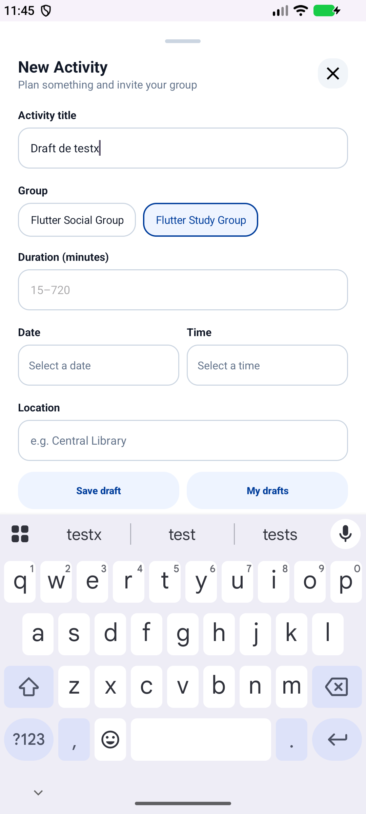
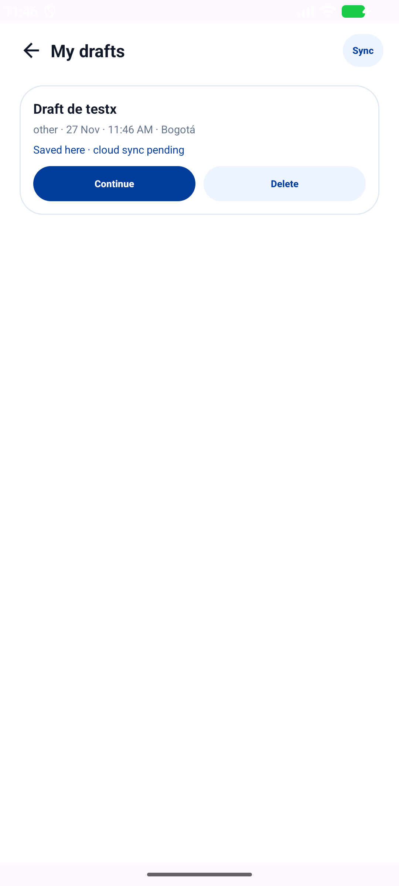
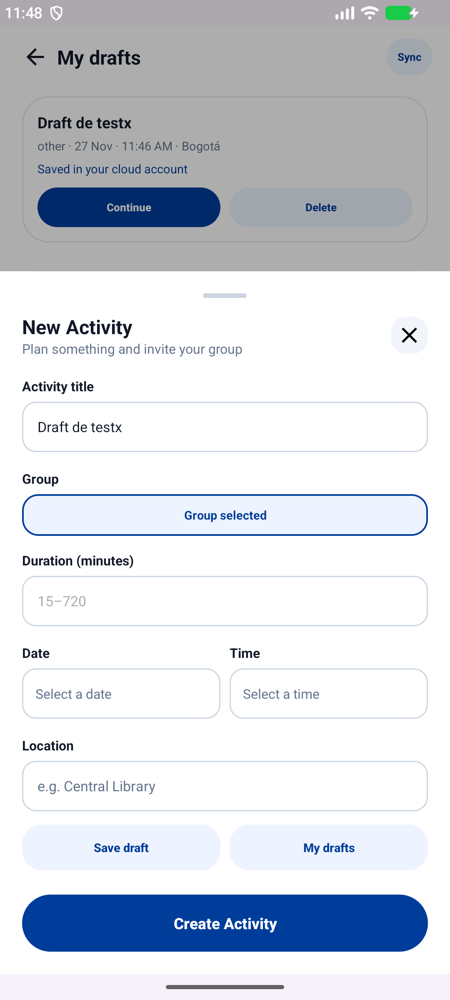
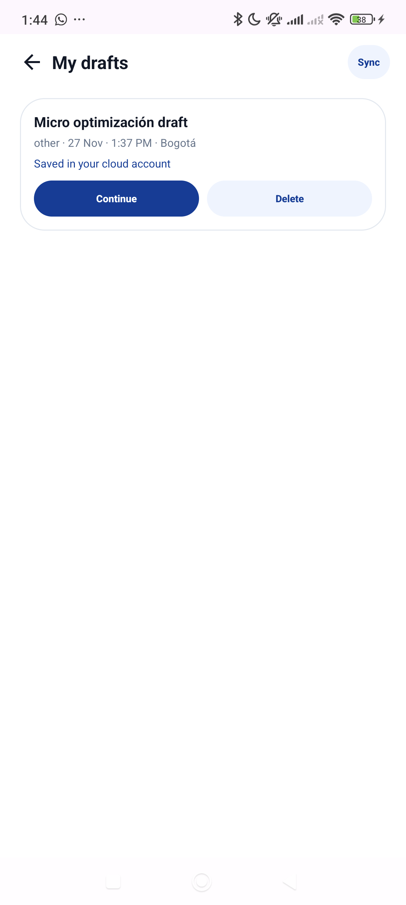
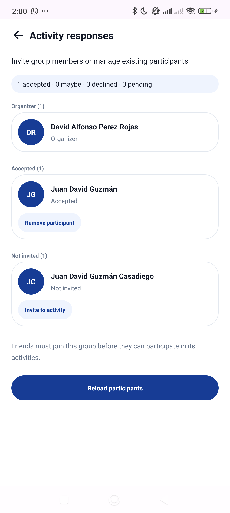

# ParchApp (Java), Sprint 4: David Alfonso Pérez Rojas

This page covers David's part of Sprint 4: the micro-optimization with its
profiling evidence (point 3), the new activity drafts feature (point 4), and
the features and strategies used by the Java app (point 5).

The profiling was done on David's phone (Xiaomi 2311DRK48G, Android 15) with a
debug build against the real Firebase project `parchapp-ee6cc`. The draft-flow
screenshots were taken on the local Android emulator with the `demo-parchapp`
Firebase emulators, so the UI is the same but the accounts and data are local.

---

## 3. Micro-optimization: My drafts renders the list only when it changed

### Where and why

`ActivityDraftsActivity` loads the local drafts first and then synchronizes
with the private cloud drafts. Both calls end in `render(drafts)`. Before the
optimization every call removed all cards and inflated every row again:

- local load → `container.removeAllViews()` + inflate rows,
- sync answer → the same list is rendered again,
- with 1 draft this cost about 15–20 ms per render, twice per opening,
- with a longer draft list the removed/recreated views grow with the list.

The second render is usually identical when the cloud answer has the same
drafts and sync status. The optimization keeps a signature of the rendered
list and returns before touching the views when the signature did not change.

### The code

```java
private String renderedSignature;

private void render(List<SavedActivityDraft> drafts) {
    String signature = signature(drafts);
    if (signature.equals(renderedSignature)) return;
    renderedSignature = signature;
    long started = System.nanoTime();
    BackgroundThreads.beginSection("ActivityDrafts.render");
    try {
        renderRows(drafts);
    } finally {
        BackgroundThreads.endSection();
        Log.d("ParchPerf", String.format(Locale.US,
                "Drafts.render %d rows in %.2f ms",
                drafts.size(), (System.nanoTime() - started) / 1_000_000.0));
    }
}

private static String signature(List<SavedActivityDraft> drafts) {
    StringBuilder value = new StringBuilder();
    for (SavedActivityDraft draft : drafts) {
        value.append(draft.getId()).append(':')
                .append(draft.getRevision()).append(':')
                .append(draft.getUpdatedAt()).append(':')
                .append(draft.getSyncStatus()).append(':')
                .append(draft.getLocalState()).append(':')
                .append(draft.getActivity().getTitle()).append('|');
    }
    return value.toString();
}
```

The signature includes the cloud status, so a pending draft that becomes
synced still repaints. Deleting, continuing or changing a draft also changes
the signature. The first render of every opening is still executed.

### How it was measured

1. **Perfetto**, the Android system profiler, recorded on the phone with adb.
   The trace section `ActivityDrafts.render` was added to both builds before
   the comparison, so the "before" and "after" runs are measured the same way.
2. **ParchPerf logcat** records the duration and row count of every render.

The same phone and script were used for both builds: 20 cold openings of
`ActivityDraftsActivity` with one saved draft. The trace was recorded with:

```bash
adb shell perfetto --background -o /data/misc/perfetto-traces/drafts-before.pftrace \
    -t 75s -b 64mb --app com.example.parchapp sched freq gfx view am
# 20 x:
adb shell am force-stop com.example.parchapp
adb shell am start -S -n com.example.parchapp/.ActivityDraftsActivity
adb pull /data/misc/perfetto-traces/drafts-before.pftrace
```

The `.pftrace` files were read with Perfetto `trace_processor` and the same
query on both builds:

```sql
SELECT name, count(*) AS calls, ROUND(SUM(dur)/1e6, 2) AS total_ms,
       ROUND(AVG(dur)/1e6, 2) AS avg_ms
FROM slice WHERE name = 'ActivityDrafts.render' GROUP BY name;
```

### Results: before and after

Perfetto captured 5 complete cold openings in each trace:

| Trace section | Before: calls | Before: total | Before: average | After: calls | After: total | After: average |
|---|---:|---:|---:|---:|---:|---:|
| `ActivityDrafts.render` | 10 | 158.47 ms | 15.85 ms | 5 | 79.07 ms | 15.81 ms |

ParchPerf logcat over the 20 cold openings:

| Build | Render lines | Render time each |
|---|---:|---:|
| Before | 40 (2 per opening) | 13.56–24.91 ms |
| After | 20 (1 per opening) | 13.39–19.39 ms |

### What the numbers say

- The number of renders per opening goes from 2 to 1. On the captured trace,
  total render time goes from 158.47 ms to 79.07 ms, **50.1 percent less**.
- The average render stays at about 15.8 ms. The row binding and layout cost
  did not change; the gain is that the identical second render no longer runs.
- The optimization does not hide changes: the signature includes the revision,
  edit time, sync status and local state, so a real change still repaints.
- The first render is still needed. The improvement is for the common case
  where the local list and the cloud answer are the same.

### Evidence files

- `docs/evidence/sprint4/david/drafts-perfetto-traces.zip` (`before` and `after` traces)
- `docs/evidence/sprint4/david/drafts-perfetto-summary.txt`
- `ParchApp-drafts-before.apk` and `ParchApp-drafts-after.apk` (same phone and test data)

---

## 4. New feature: Activity drafts

The Java app now has the Flutter activity-drafts flow:

| New Activity with Save draft / My drafts | My drafts, pending sync | My drafts, cloud synced | Continue a draft |
|---|---|---|---|
|  |  |  |  |

On the real phone:



**How it works**

- `CreateActivitySheet` has **Save draft** and **My drafts**.
- It auto-saves when the sheet stops (back/close) if the fields changed.
- The draft keeps its own `requestId`, so a publication is retried with the
  same identity and `publishActivity` stays idempotent.
- When the activity is published, the draft is marked `published`; if
  publication fails, the draft stays active.
- `ActivityDraftsActivity` lists drafts with **Continue**, **Delete**, **Sync**
  and the basic conflict actions **Use cloud** and **Keep local**.
- Continuing a draft opens the same creation form with the title, group, date,
  time, duration and place restored.

**Backend**

No new backend was needed. It uses the existing private callables:

- `getActivityDrafts({cursor})` reads the user's private drafts.
- `syncActivityDraft({id, operationId, expectedVersion, state, category,
  payload, requestId, clientUserId})` creates, edits, deletes and closes them.
- `operationId` makes retries idempotent; `expectedVersion` detects changes
  made on another device.

**MVP scope**

Java stores the fields available in the Java form. Description is empty and
category is `other` for now. Drafts created in Flutter with map details or
planning metadata may lose those extra fields if edited only in Java; this is
the main remaining difference with the Flutter implementation. History and the
draft comparator were left out of the MVP.

---

## 4b. Activity responses by status

The responses screen now shows each activity's members grouped by their answer:
**Accepted**, **Maybe**, **Declined**, **Pending**, plus the organizer and group
members who have not been invited yet. A summary at the top gives the counts,
so the organizer can see the state of the activity without scrolling through
the list.



The screen is opened with **Responses** from the next-plan card in the group
and from the activity-created screen. The organizer actions (invite, remove,
reload) and the participant join/invitation actions keep working inside the
same grouped list. The status comes from the member's `response` value returned
by `getActivityParticipants`; pending means the member was invited but has not
answered.

---

## 5. Features and strategies (David)

### a. Features

| Feature | Sprint 4 |
|---|---|
| **Activity drafts** (new view) | Save, auto-save, My drafts, continue, delete, sync and basic conflict resolution |
| Activity participants | Responses grouped by Accepted/Maybe/Declined/Pending with counts, avatars with user photos, local snapshot, offline actions |
| Profile photos | Upload to Firebase Storage with `photoUrl`; Picasso for avatars |

### b. Micro-optimization

`ActivityDraftsActivity` avoids the duplicate list render, as shown in point 3.

### c. Eventual connectivity

| Where | Strategy | Why | Sprint |
|---|---|---|---|
| Activity drafts | Local Room outbox; `ActivityDraftsSyncCoordinator` with `ConnectivityManager.NetworkCallback` and a serial executor. Sends when the screen opens, when the app opens and when the network returns. No WorkManager for drafts. | A draft can be written on the bus; publishing still needs the backend | 4 |
| Activity participants | Room outbox for join/invite/remove; **WorkManager** with `NetworkType.CONNECTED` and exponential backoff. It is the current implementation; the team agreed to move it to the same `ConnectivityManager` coordinator later. | Keeps the organizer's actions without losing them offline | 4 |
| Profile photo | Storage upload; if Storage fails, the app falls back to the existing `photoData` path | The profile update must not be blocked by a Storage failure | 4 |

### d. Local storage

| Where | Strategy | Why | Sprint |
|---|---|---|---|
| Activity drafts | Room v5 table `activity_drafts`: owner, id, revision, updatedAt, category, state, payload JSON, remoteVersion, pending, operationId, syncError, requestKey | Survives process death and supports idempotent cloud sync | 4 |
| Participants | Room v4 tables `participant_cache` and `participant_outbox` | Last list offline and queued actions | 4 |
| Availability | Existing `SharedPreferences` status keys per account | Keeps the user's own status and sync state | 3 |

### e. Multithreading

| Where | Strategy | Why | Sprint |
|---|---|---|---|
| Drafts local store | `ExecutorService` serial queue `parch-drafts`; network callbacks post to the main thread | Room and network never block the UI | 4 |
| Participants | `ParticipantLocalStore` with a fixed pool of 2 and a `Handler` on the main thread | Snapshot and pending actions load independently | 4 |
| Draft sync | `ActivityDraftsSyncCoordinator` uses `ConnectivityManager` callbacks and reuses the serial repository queue | One sync at a time, no duplicate writes | 4 |
| Activity participants actions | WorkManager (current); the `ParticipantActionWorker` runs the callable on a worker and updates Room | Offline actions are retried by the system | 4 |

### f. Caching

| Where | Strategy | Why | Sprint |
|---|---|---|---|
| User avatars | Picasso memory + disk cache, `networkPolicy(OFFLINE)` without network, initials fallback | User photos are reused while scrolling and remain visible offline | 4 |
| Activity participants list | Last successful `ActivityParticipants` snapshot in Room | The screen opens offline without waiting for the callable | 4 |
| Activity drafts | Local list is the immediate source; the cloud answer replaces it when it arrives | Opening My drafts does not wait for the network | 4 |

---

## Evidence

`docs/evidence/sprint4/david/` contains the before/after Perfetto traces
(`drafts-perfetto-traces.zip`), the summary (`drafts-perfetto-summary.txt`) and
the four draft-flow screenshots plus the phone screenshot.

Tests:

- Backend `activity.participants` + `mobile.api`: 27 passed.
- Java: build successful and unit tests successful, including
  `ActivityDraftTest`.
- Manual real-phone run: 20 cold openings for the Perfetto comparison and the
  draft list screenshot.

The APKs used for the two profiling runs are `ParchApp-drafts-before.apk` and
`ParchApp-drafts-after.apk` in the Downloads folder.
