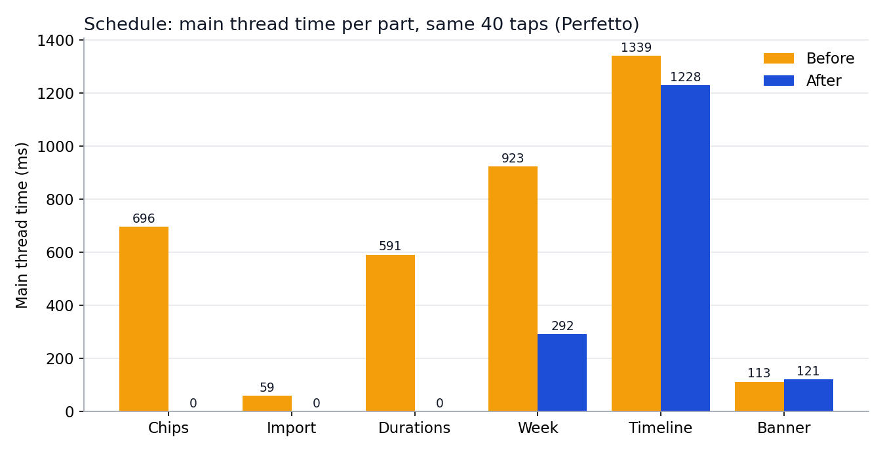
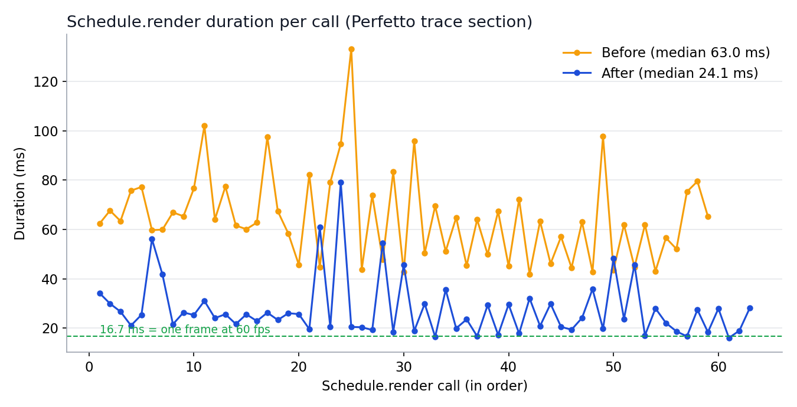
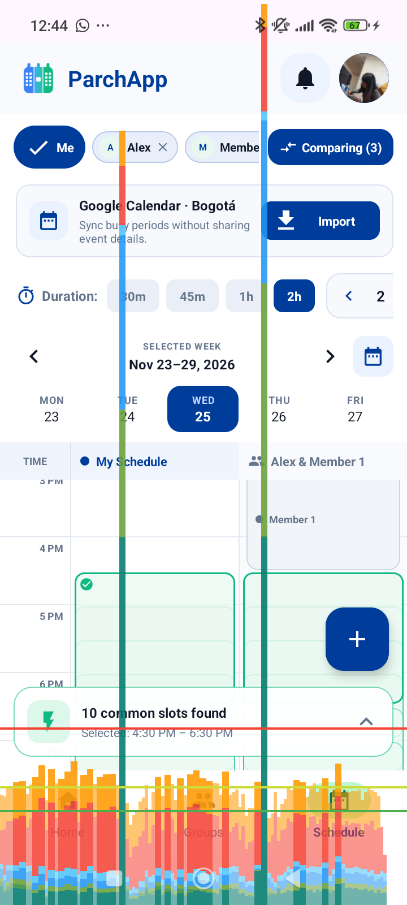
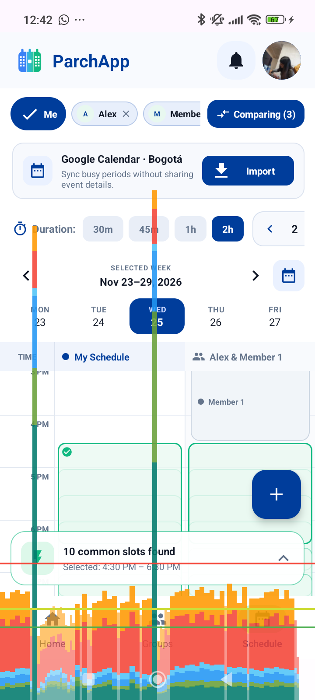
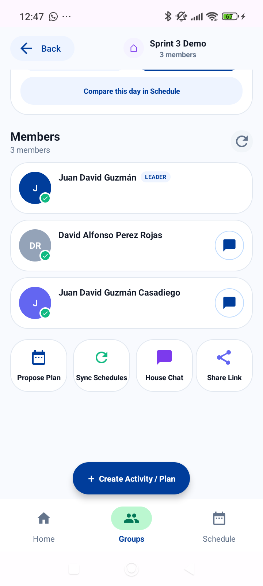
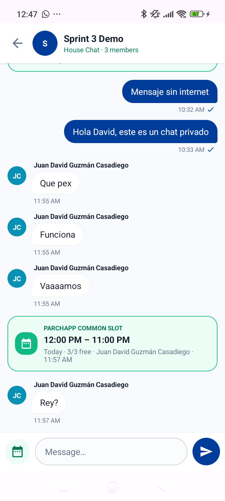

# ParchApp (Java), Sprint 4: Juan David Guzmán Casadiego

This page covers Juan David's part of Sprint 4: the micro-optimization with its profiling evidence (point 3), his new view (point 4), and the list of his features and strategies across Sprints 2, 3 and 4 (point 5).

All measurements were taken on Juan David's phone (Xiaomi 25078RA3EL, Android 15 / HyperOS) with a debug build, against the real Firebase project.

---

## 3. Micro-optimization: Schedule renders only what changed

### Where and why

`ScheduleActivity` is the screen with the most views in the app. Its layout holds the friend chips, the Google Calendar card, the duration chips, the week strip and a timeline with hour lines, busy blocks and common slots. Before Sprint 4, **every change called `render()`, which deleted and recreated all six parts**, including parts that had not changed:

- Changing the duration (30m → 45m) rebuilt the friend chips, the Google Calendar card and the week strip, although none of them depend on the duration.
- Changing the day called `render()` twice, once for the loading state and once with the answer, so the chips and the week strip were rebuilt twice per tap.
- Each timeline render removed and recreated the 16 hour lines of each lane (32 views), although they never move.
- Every view creation parsed its color from text (`Color.parseColor("#64748B")`), and every date label created a new `SimpleDateFormat`, which parses its pattern and loads locale data.

All of this runs on the **main thread**, so it competes with drawing the frame.

### The four micro-optimizations (branch `perf/jd-schedule-render`)

**1. Partial render with dirty flags.** Each part of the screen is a bit. A change only draws the parts it touches:

```java
// micro-optimization 1: the parts of the screen; a change only draws again the parts it touches
private static final int PART_CHIPS = 1;
private static final int PART_IMPORT = 1 << 1;
private static final int PART_DURATIONS = 1 << 2;
private static final int PART_WEEK = 1 << 3;
private static final int PART_TIMELINE = 1 << 4;
private static final int PART_BANNER = 1 << 5;
// what a new day or a new answer always changes: the blocks, the common slots and their banner
private static final int PART_DAY = PART_TIMELINE | PART_BANNER;

private void renderParts(int parts) {
    ...
    if ((parts & PART_CHIPS) != 0) traced("Schedule.renderChips", this::renderChips);
    if ((parts & PART_IMPORT) != 0) traced("Schedule.renderImport", this::renderImport);
    if ((parts & PART_DURATIONS) != 0) traced("Schedule.renderDurations", this::renderDurations);
    if ((parts & PART_WEEK) != 0) traced("Schedule.renderWeek", this::renderWeek);
    if ((parts & PART_TIMELINE) != 0) traced("Schedule.renderTimeline", this::renderTimeline);
    if ((parts & PART_BANNER) != 0) traced("Schedule.renderBanner", this::renderBanner);
}
```

The callers say what they changed: `selectDay` → `refreshDay(PART_WEEK)`, `toggleFriend`/`toggleCompare` → `refreshDay(PART_CHIPS)`, `setDuration` and the network answer → `render(PART_DAY)`.

**2. Hour lines created once.** The lines are the first children of each lane, so only the blocks and slots after them are removed:

```java
private static final int HOUR_LINES = (END - START) / 60 + 1;

private void keepOnlyHourLines(FrameLayout lane) {
    if (lane.getChildCount() < HOUR_LINES) {
        lane.removeAllViews();
        addHourLines(lane);
    } else if (lane.getChildCount() > HOUR_LINES) {
        lane.removeViews(HOUR_LINES, lane.getChildCount() - HOUR_LINES);
    }
}
```

**3. Colors parsed once.** The 7 colors of the screen are `static final int` constants (`C_64748B`, `C_E8EDF5`, …) instead of `Color.parseColor("#…")` on every view.

**4. One `SimpleDateFormat` per pattern.** The week strip asked for 11 new formatters on every render. Now they are kept in a map. It is only used on the main thread, so a formatter (which is not thread-safe) is never shared between threads:

```java
private static final Map<String, SimpleDateFormat> FORMATS = new HashMap<>();

private static String format(String pattern, Calendar day) {
    SimpleDateFormat format = FORMATS.get(pattern);
    if (format == null) {
        format = new SimpleDateFormat(pattern, Locale.US);
        format.setTimeZone(BOGOTA);
        FORMATS.put(pattern, format);
    }
    return format.format(day.getTime());
}
```

### How it was measured (profiling tools)

1. **Perfetto**, the Android system profiler (the same system trace that the Android Studio CPU profiler records). The render is instrumented with trace sections (`android.os.Trace` through `BackgroundThreads.beginSection`): `Schedule.render` and one section per part (`Schedule.renderChips`, `Schedule.renderTimeline`, …). This instrumentation was committed **before** the optimization (commit `50059ca`), so both builds are measured in the same way.
2. **Profile GPU rendering** (Developer options → "Profile HWUI rendering" → "On screen as bars"), to see the frame times on the phone.

The same script ran on both builds on the same phone, in the same group (Me + 2 friends, 13 common slots): **20 duration changes** (30m, 45m, 1h, 2h five times) and **20 day changes** (Monday to Friday four times), with Perfetto recording:

```bash
adb shell perfetto --background -o /data/misc/perfetto-traces/before.pftrace -t 75s -b 64mb \
    --app com.example.parchapp sched freq gfx view am
# ... the 40 taps with adb shell input tap ...
adb pull /data/misc/perfetto-traces/before.pftrace
```

The traces were read with Perfetto's `trace_processor` (SQL over the `slice` and `actual_frame_timeline_slice` tables). The two `.pftrace` files can also be opened at https://ui.perfetto.dev.

### Results: before and after

**Perfetto summary (main thread, same 40 taps):**

| Trace section | Before: calls | Before: total | Before: median | After: calls | After: total | After: median |
|---|---|---|---|---|---|---|
| `Schedule.render` | 59 | 3812 ms | **63.0 ms** | 63 | 1733 ms | **24.1 ms** |
| `renderChips` | 59 | 696 ms | 10.6 ms | 0 | 0 ms | – |
| `renderImport` | 59 | 59 ms | 0.9 ms | 0 | 0 ms | – |
| `renderDurations` | 59 | 591 ms | 9.1 ms | 0 | 0 ms | – |
| `renderWeek` | 59 | 923 ms | 15.2 ms | 21 | 292 ms | 13.5 ms |
| `renderTimeline` | 59 | 1339 ms | 25.2 ms | 63 | 1228 ms | 21.4 ms |
| `renderBanner` | 59 | 113 ms | 1.7 ms | 63 | 121 ms | 1.8 ms |
| `measure` (framework) | 43 | 984 ms | 29.2 ms | 46 | 324 ms | 23.2 ms |
| `traversal` (framework) | 787 | 5394 ms | 4.1 ms | 827 | 4855 ms | 4.1 ms |
| `Choreographer#doFrame` (total) | 854 | 8245 ms | 4.7 ms | 893 | 6874 ms | 4.7 ms |





**Profile GPU rendering on the phone (after 8 day changes).** Each tall vertical bar is the frame of a day change; the green line is 16 ms.

| Before | After |
|---|---|
|  |  |

### What the numbers say

- **A render is 2.6× faster**: median 63.0 ms → 24.1 ms, and the main thread spent 3.8 s → 1.7 s rendering for the same 40 taps (−55 %). In the GPU bars the frame of a day change used to go past the top of the screen and now stops halfway.
- **The work that was not needed disappeared**: chips, Google Calendar card and duration chips went from 1346 ms to 0 ms. The week strip is drawn 21 times instead of 59 (once per day change, never on a duration change).
- **Fewer views means less layout**: the framework's `measure` went from 984 ms to 324 ms, and the total frame time (`Choreographer#doFrame`) from 8.2 s to 6.9 s.
- **What did not change, said honestly:** the cost of one week strip render barely moved (15.2 → 13.5 ms), so most of the gain in that part comes from drawing it fewer times, not from reusing the formatter. Perfetto's frame timeline shows "App Deadline Missed" at 40 frames before and 44 after; the increase in janky frames (241 → 333) is all "Buffer Stuffing", which is the queue of the compositor, not the app missing its deadline. The timeline is still about 21 ms per render, because it creates a view for every busy block and every slot. Reusing those views would be the next optimization.

Raw output of the analysis: [`evidence/sprint4/schedule-perfetto-summary.txt`](evidence/sprint4/schedule-perfetto-summary.txt).

---

## 4. New view: Group Chat (House Chat and direct chats)

From **Group Details** a member opens the **House Chat** of the group, or a **direct chat** with one member from the chat button next to their name. A message can also be a **common slot card**: the calendar button computes the best common free slot left today with the F4 engine and shares it in the chat.

| Group Details: chat buttons | House Chat | Direct chat |
|---|---|---|
|  |  |  |

**How it works**

- Messages live in Firestore: `groups/{groupId}/messages` for the House Chat and `directChats/{a_b}/messages` for two people, where `a_b` are both uids sorted, so both people get the same id.
- Firestore rules: only the members (or the two people) can read and create; the sender must be the signed-in user, the text has 1 to 2000 characters and `createdAt` must be the server time. Messages cannot be edited or deleted. Tested in the emulator (`tests/chat.rules.test.js`).
- New messages reach the other people in the **notifications screen** (bell): one alert per chat, replaced by each new message and unread again after it was read; tapping it opens the chat. A Firestore trigger in the backend writes the alert (`chatAlerts.js`, `tests/chat.notifications.test.js`).

**Sprint 4 subgroup requirement: a different multithreading strategy and micro-optimizations in the view**

- **HandlerThread + Looper** (`util/ChatThread.java`): one background thread `parch-chat` with its own message queue. The Firestore listener runs on it (`addSnapshotListener(ChatThread.EXECUTOR, MetadataChanges.INCLUDE, …)`), turns the documents into rows and adds the date dividers there, then posts the list to the main thread. The date formatters belong to that thread only, so they need no locks. This is different from the executors (pools and serial queues) used in Sprint 3.
- **Micro-optimizations:** `ListAdapter` + `DiffUtil` (the diff is computed off the main thread and only the changed rows are drawn), stable ids, `setHasFixedSize(true)`, each `ViewHolder` finds its views once, and only the last 100 messages are read (`limitToLast(100)`).

---

## 5. Features and strategies by sprint (Juan David)

### a. Features

| Feature | Sprint 2 | Sprint 3 | Sprint 4 |
|---|---|---|---|
| **F4. Best-slot recommender** (responsible, smart feature) | `AvailabilityEngine` + `OverlapRanking` (Strategy) | Off the main thread, works offline | Used by the chat to share the best common slot of today |
| **F5. Sign in with Firebase Auth** (responsible, authentication) | Email and password, Google Sign-In | Google Sign-In fixed (OAuth client and SHA), Continue as, Log out, offline handling | – |
| F1. Automatic Commuting status | Live status card in the Dashboard | Motion sensor (Commute / In Transit) | – |
| F2. Recommended slot (BQ3) | Recommended badge in Compare Availability | Same, works with cached data | – |
| F3. Context-aware plan card | Plan card in Today's Plans | Travel time, "You won't make it on time", offline banner | – |
| F6. Groups, activities and RSVPs | Dashboard reads groups and today's plans | In parallel, cache then network | – |
| F7. Travel time from Google Maps | Travel time cached per activity | Reused only nearby | – |
| Schedule | – | Flutter design: Google Calendar import, timeline, common slots, duration stepper | Renders only what changed (point 3); same view as the Flutter `sch-back` branch (last updated banner, integrations row, no default friends); **friends hidden while offline** (teacher's correction) |
| **Group Chat** (new view) | – | – | House Chat, direct chats, common slot card, offline sending |
| **Chat notifications** | – | – | New messages in the notifications screen, open the chat |
| **Andes Events** (ported from Flutter) | – | – | University events catalog, search and categories, saved events, Add / Remove from Schedule (the event becomes busy time in Schedule), offline add queue |

Details and evidence of the Schedule changes and Andes Events: [sprint4-schedule-andes-events.md](sprint4-schedule-andes-events.md).

### b. Business questions

| BQ | Type | Made by | Rationale |
|---|---|---|---|
| **BQ1**: average response time of the availability engine by group size | Type 1, App Telemetry | Juan David | The recommender must answer quickly for large groups; the event `availability_calc` (group size, duration, number of slots, ranking) is logged from the worker thread, so the team knows when the engine needs optimizing. |
| **BQ9**: how often is Compare Availability used before creating an activity, and how does that affect the percentage of activities that reach Confirmed | Type 3, Feature Analysis | Juan David | Compare Availability is the core of ParchApp; this tells the team whether it is used and whether it pays off. The app logs `activity_created` (with its source) and `activity_confirmed`; the backend computes the rate in `insights/bq9_compare_usage`, shown in the team dashboard. |

### c. Eventual connectivity

| Where | Strategy | Why | Sprint |
|---|---|---|---|
| Sign In (F5) | Network only to sign in; Continue as uses the local Firebase Auth session; Google is not opened offline | Signing in needs the server, but a returning user should not be blocked | 3 |
| Dashboard (F6, F1, F3) | Cache, then network (`Source.CACHE` → `Source.DEFAULT`), reload when the network returns | Saved plans on screen in 86 ms instead of waiting 9.7 s for Firestore to give up | 3 |
| Compare Availability (F4, F2) | Cached group data, local computation, network only to publish | The slots can be computed on the phone; only creating the plan needs the server | 3 |
| Schedule | Memory → network → saved copy, with the time it was saved | The user sees their week offline and knows it may be old | 3 |
| **Group Chat** | Firestore offline persistence: the chat opens with the saved messages; a message sent offline is written locally at once, shown with a clock and "Sending…", and sent by Firestore when the network returns; offline banner (`ConnectivityWatcher`) | A chat must let you write without network; the server time keeps the order right | **4** |
| Shared pieces | `ConnectivityWatcher` (banner + reload on reconnect), `OfflineGuard` (check on every tap, network error vs other errors) | Nothing stays disabled after reconnecting, messages are honest | 3 |
| **Schedule offline** | Offline only my saved schedule is shown: friend chips hidden, Add friends and Compare blocked with a message, a day saved with friends reduced to my blocks, no friends sent when planning; amber banner with the last update; on reconnect friends and the day reload and a green "Schedule updated" shows for 5 s | The teacher's correction: friends' data can be old offline, so they must not appear in the comparison | **4** |
| **Andes Events** | Outbox `AndesOutbox`: "Add to Schedule" is saved on the phone first, then sent (pending → syncing → confirmed / failed); a lost connection keeps it pending, a refusal from the backend becomes failed and waits for Retry; sent when the screen opens, when the app opens online and every time the connection returns; offline banner with the last sync; removing needs the network | The user can add an event without network and it reaches the backend later without duplicates | **4** |

### d. Local storage

| Where | Strategy | Why | Sprint |
|---|---|---|---|
| Schedule days | **Room** table `schedule_days`, key (owner, day), index (owner, savedAt), 30 newest days per user deleted by one SQL query, on a serial queue | Relational data per user and day, with a size limit enforced by the database | 3 |
| Schedule friends list, Alerts copy | SharedPreferences (JSON per user) | Small values always read whole by one key | 3 |
| Alerts copy | Now also keeps the chat of each chat alert, so it opens the chat offline | Same reason | **4** |
| Group Chat | Firestore local cache (persistence) | The last 100 messages of each chat stay on the phone for offline reading and pending writes | **4** |
| **Andes Events** | **Room** table `andes_events` (migration 2 → 3), key (owner, list, eventId), three lists: `catalog` (public events of the next 15 days), `saved` (bookmarks per account) and `outbox` (adds waiting for the backend) | Many rows per user that are filtered by date and status, and the outbox must survive closing the app | **4** |
| Andes Events | SharedPreferences `catalog.lastSync` | One value: the time of the last confirmed catalog, shown in the offline banner | **4** |
| Schedule offline | Room query `newestOfDate(owner, date)` over `schedule_days` | Offline, find the newest saved copy of a day even if it was saved with friends, and keep only my blocks | **4** |

### e. Multithreading

| Where | Strategy | Why | Sprint |
|---|---|---|---|
| Dashboard | Fixed pool of 2 named threads (`parch-dashboard`) for two independent Firestore reads, results posted to the main thread | Screen ready after the slower read, not the sum (1.84 s instead of 3.33 s) | 3 |
| AvailabilityEngine (F4) | Single-thread executor used as a serial queue (`parch-availability`) | CPU work off the main thread; answers arrive in order, so no locks are needed | 2–3 |
| Room (Schedule) | Serial queue `parch-schedule-db` | Disk I/O off the main thread, one write at a time | 3 |
| **Group Chat** | **HandlerThread + Looper** (`parch-chat`) as the executor of the Firestore listener; rows built there, list posted to the main thread | A long-lived listener needs one thread with its own queue; thread confinement for the formatters | **4** |
| **Chat list** | `DiffUtil` on a background thread (`ListAdapter`) | Only the changed rows are drawn | **4** |
| **Andes Events** | Two serial queues: `parch-andes-db` for Room and `parch-andes-outbox` for sending the adds; results posted to the main thread | One write at a time, and two syncs can never send the same add twice | **4** |
| Andes Events | Cached copy and network request started at the same time; a generation number drops an old or late answer | The screen shows the saved events at once, and a slow answer never replaces a newer one | **4** |

### f. Caching

| Where | Strategy | Why | Sprint |
|---|---|---|---|
| Schedule days | LRU `LinkedHashMap` in access order, 14 entries, 5-minute TTL, synchronized | A day goes from 247–352 ms over the network to 0 ms from memory; the TTL because a friend can change their calendar | 3 |
| Profile photo | **Glide** with `AppGlideModule`: memory cache of 2 screens, 20 MB disk cache | Small round photos shown on every screen | 3 |
| Group Chat | `limitToLast(100)` over the Firestore cache | An old chat does not load or keep everything | **4** |
| Schedule | Colors and date formatters computed once and reused (point 3) | Less work on the main thread per render | **4** |
| **Andes Events** | Rolling window of 15 days in Bogotá time (`AndesCacheWindow`); events evicted by date, not LRU; the saved copy is shown first and the confirmed answer replaces screen and copy in one transaction | Events expire by time, so the date decides what is worth keeping | **4** |
| Schedule | `forgetDaysInMemory()` clears the in-memory days when an Andes event is added or removed | The next Schedule load asks the backend, so the new busy time shows at once | **4** |
