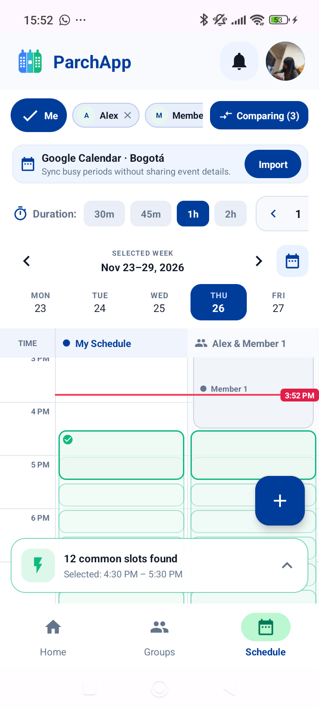
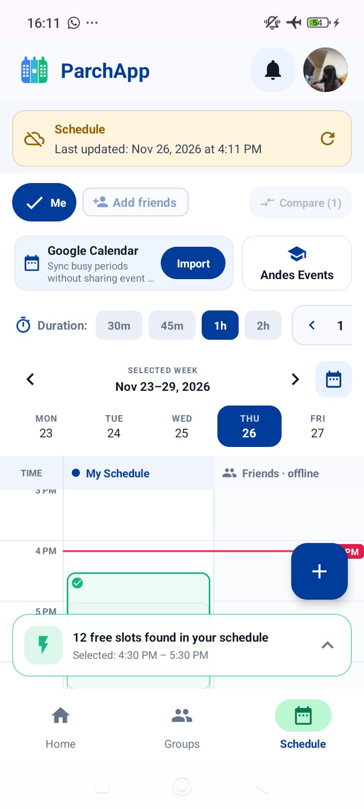
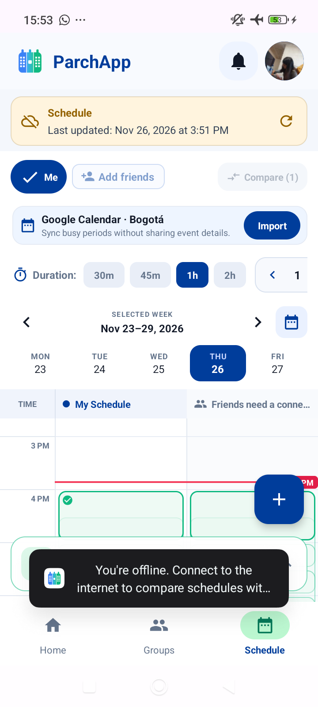
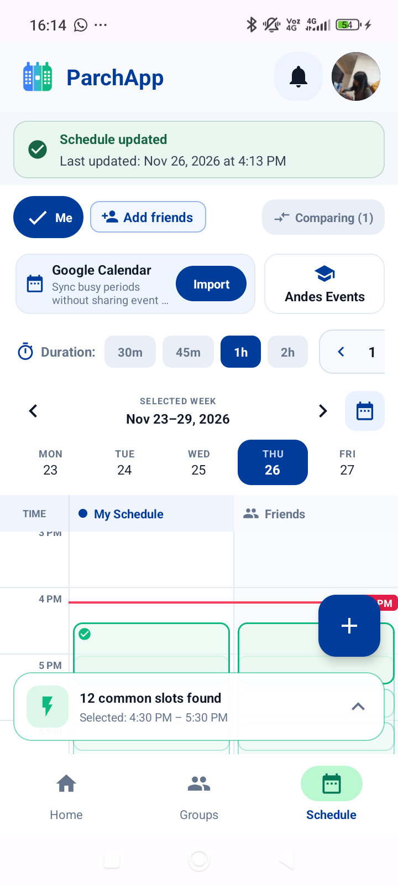
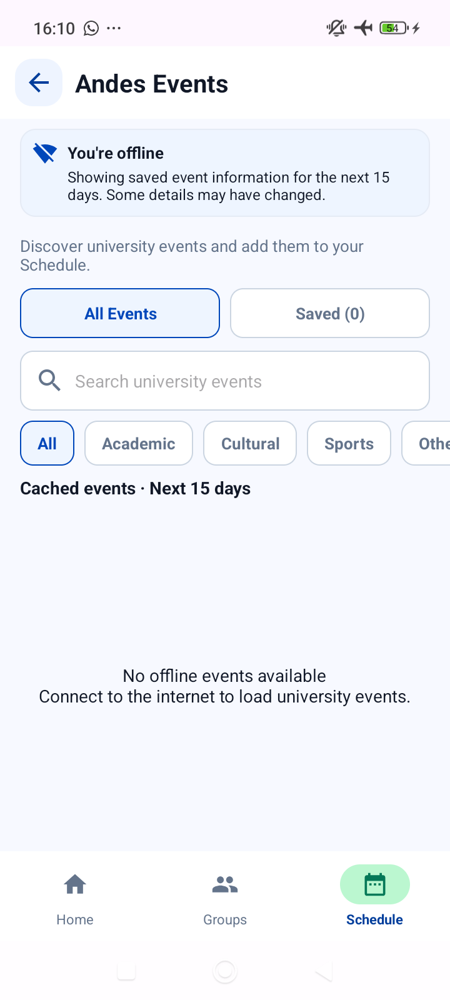
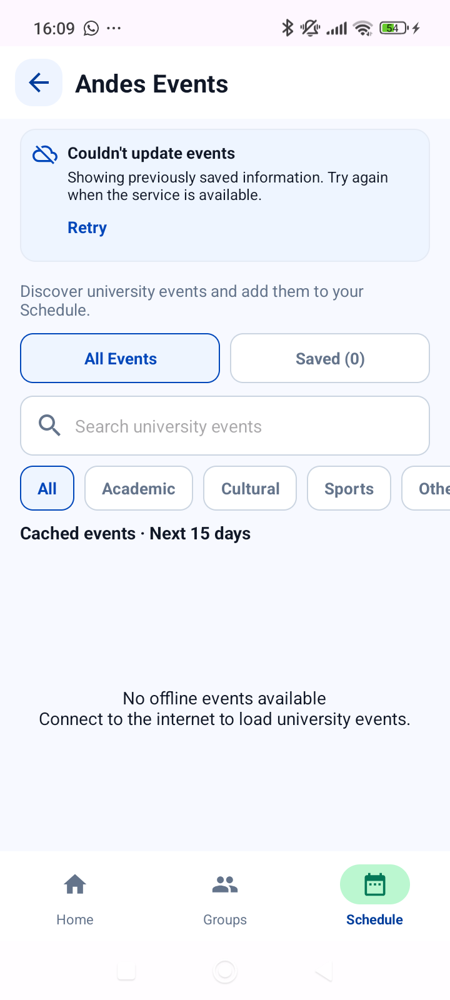

# Sprint 4: Schedule like Flutter `sch-back`, friends hidden offline, and Andes Events (Java)

Author: Juan David

## 1. Same Schedule view as the Flutter `sch-back` branch

These changes are in `ScheduleActivity` and `activity_schedule.xml`:

- **Last updated banner.** This is the Flutter `ScheduleLastUpdatedBanner`.
  - Offline it is amber. It shows the time the schedule on screen came from the backend and a refresh button.
  - After the connection comes back and the day loads, it shows a green "Schedule updated" for 5 seconds.
- **Integrations row.** It has a compact Google Calendar card (Import, Importing, Imported, Try again) and an **Andes Events** tile.
- **No friends selected by default.** The old version selected the first two friends, which is why Alex always showed up. A selection the user makes is kept while those people are still friends.
- **No loading bar** under the week.

## 2. Teacher's correction: no friends in the comparison while offline

While offline, Schedule only shows **my** saved schedule:

- The friend chips disappear and the friends lane says "Friends · offline".
- "Add friends" and "Compare" are dimmed. Tapping them explains that comparing needs a connection.
- The banner says "N free slots found in your schedule", not "common slots", because nobody is being compared.
- A day saved together with friends is reduced to my own blocks. This uses `OfflineScheduleRepository.onlyOwner` and `ScheduleDayDao.newestOfDate`.
- The same rule applies when the network is up but the backend does not answer, and the day comes from the phone.
- Planning while offline never sends friends as participants.
- When the connection returns, friends and the day are loaded again automatically.

| Online, comparing | Offline | Offline, Add friends | Reconnected |
|---|---|---|---|
|  |  |  |  |

## 3. Andes Events (ported from Flutter)

The screen is `AndesEventsActivity`. It reproduces the Flutter `AndesEventsView`:

- A banner for offline, reconnecting or backend errors, with the last sync time.
- All Events / Saved tabs, search, categories, and cards with a bookmark.
- A details sheet, and Add to / Remove from Schedule.

**Backend.** Java talks to the backend through callables, like the rest of the app. The callables are in `Backend/functions/src/andesEvents.js`:

- `getAndesEvents` returns the published upcoming events from `andesEvents` (the same catalog Flutter uses) and the events I already added.
- `addAndesEventToSchedule` re-reads the event inside a transaction. It refuses a missing, ended or changed event, and adding the same event twice is safe.
- `removeAndesEventFromSchedule` removes an added event.

Added events are stored in `andesSchedule/{uid}/events` as busy minutes. `getScheduleDay` merges them into the busy time. This has two effects:

- The event counts in comparisons, and friends only ever see busy minutes.
- Importing Google Calendar again does not erase the event.

**Strategies:**

- **Caching.** A rolling 15-day window in Bogotá (`AndesCacheWindow`) is stored in Room in the table `andes_events`, list `catalog`.
  - Events are evicted by date, not LRU, because events expire by time.
  - The copy on the phone is shown immediately while the backend is asked. The confirmed answer replaces both the screen and the copy in one transaction.
- **Local storage.** Room table `andes_events`, migration 2 → 3, holds three lists:
  - `catalog` (public)
  - `saved` (bookmarks per account, never evicted)
  - `outbox` (adds waiting for the backend)

  The time of the last confirmed catalog is a single value, so it lives in SharedPreferences.
- **Eventual connectivity.** `AndesOutbox` handles "Add to Schedule".
  - The request is saved on the phone first, then sent. Its states are pending → syncing → confirmed or failed.
  - A lost connection keeps the request pending. A refusal from the backend becomes failed and is only sent again after the user taps Retry.
  - Sending happens when the screen opens, when the app opens online, and each time the connection returns (`ParchApplication`).
  - Each request carries `clientUserId`, so it is never sent for another account.
  - Removing an event needs the connection.
- **Multithreading.** Room runs on its own serial queue (`parch-andes-db`). The outbox runs on another serial queue (`parch-andes-outbox`), so two syncs never send the same request twice. The screen receives the results on the main thread.
- **Concurrency.** The cached copy and the backend request start at the same time. A generation number drops an old or late answer, so it never replaces a newer one.

| Offline | Backend not deployed yet |
|---|---|
|  |  |

## Tests

- **Java unit tests:** 163, including `AndesOutboxTest`, `AndesCacheWindowTest`, `AndesCatalogParseTest` and `OfflineScheduleOwnerTest`.
- **Room on the phone:** `AndesEventsDaoTest` and `ScheduleDayDaoTest`, 7 tests.
- **Backend:** `tests/andes.events.test.js` against the emulator. It covers the catalog, the merge into `getScheduleDay`, and the refusals.
