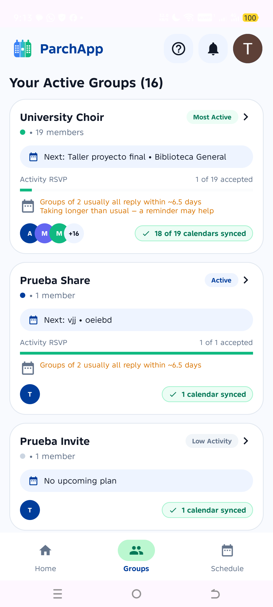
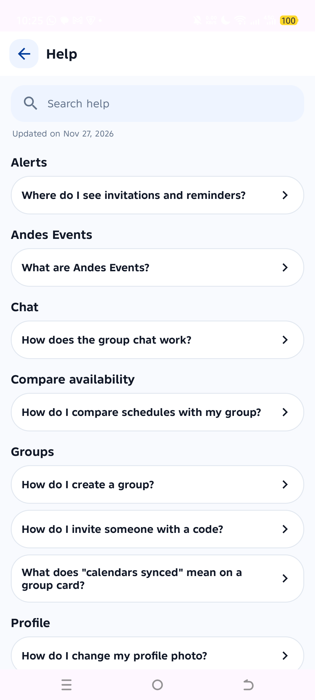
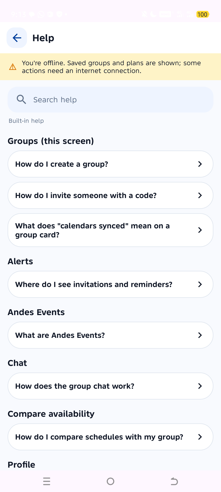

# ParchApp (Java), Sprint 4: Tatiana Pérez Suancha

All measurements were made on TODO: phone model and Android version, debug build, real Firebase project.

## 3. Micro-optimization: the Groups list

### Where and why

The Groups screen (`GroupsActivity`) is mine from Sprint 3. Before this sprint, every time the screen came back to the front (`onStart`) or the network came back, it removed all the cards and inflated them again from scratch. Each card has many views, and the code looked them up with `findViewById` about 15 times per card. For every card it also walked the whole list of plans three times, and it created a new `SimpleDateFormat` per card for the same date.

### The four micro-optimizations (class list: 1, 6 and 7), branch `perf/tp-groups-list`

| Here | From the class list |
| --- | --- |
| 1. The views of a card are found once, in a `CardViews` class | 6. Avoid calling `findViewById` often |
| 2. Cards are kept by group id and reused when the screen comes back | 1. Avoid creating unnecessary objects |
| 3. One pass splits the plans by group, and today's date is built once, outside the loop | 1. Avoid creating unnecessary objects, above all inside loops |
| 4. The card is a single `ConstraintLayout` instead of nested `LinearLayout`s | 7. `ConstraintLayout` instead of nested `LinearLayout`s |

Two details that make reuse safe: a reused card keeps what it shows until the new plans arrive, so it does not blink, and each card remembers the id of the plan its RSVP belongs to, so a late answer for an older plan is ignored.

### How it was measured (Android Studio CPU Profiler, System Trace, and Debug GPU Overdraw)

The first PR (`perf/tp-groups-trace`) only adds trace sections (`Groups.bindGroups`, `Groups.inflateCard`, `Groups.bindCard`, `Groups.bindPlans`), so the "before" and "after" builds are measured the same way. TODO: describe the test account (number of groups and plans), the phone, and the steps: open a group and come back with Back 20 times.

### Results: before and after

| Trace section | Before: count | Before: average | After: count | After: average |
|---|---|---|---|---|
| `Groups.bindGroups` | TODO | TODO | TODO | TODO |
| `Groups.inflateCard` | TODO | TODO | TODO | TODO |
| `Groups.bindCard` | TODO | TODO | TODO | TODO |
| `Groups.bindPlans` | TODO | TODO | TODO | TODO |

### What the numbers say

TODO: write what improved and what did not. If something did not improve, say so.

## 4. New view: Help (contextual help that works offline)

| Groups with the ? button | Help | Help offline |
|---|---|---|
|  |  |  |

TODO: add the three screenshots from the phone.

Help opens from a ? button in the shared top bar. It knows which screen it was opened from and shows the questions of that screen first, then the rest grouped by screen. It has a search box, the date of the last update (or "Built-in help" if it was never downloaded) and the offline banner when there is no network.

## 5. Features and strategies by sprint (Tatiana)

The rows of Sprint 2 and Sprint 3 are in the page "Sprint 3 Tatiana Extra". Here are the ones of Sprint 4.

### a. Features

| Feature | Sprint 4 |
|---|---|
| **Help** (new view) | Questions of the screen you came from first, offline search, refreshed on Wi-Fi |
| Groups list | Four micro-optimizations (point 3) |

### b. Business questions

| BQ | Type | Made by | Rationale |
|---|---|---|---|
| **BQ10**: Which activity categories, study, sports, social, or other, are selected most and least frequently, and what percentage of activities in each category reach Confirmed status? | Type 3, Feature Analysis | Tatiana | Shows whether the current categories are useful, which ones to prioritize and whether new ones are needed. Answered in the team dashboard with filters by dates, group size and category (BQ10 explorer, callable `getCategoryConfirmation`). |

The explorer filters by period (7, 14, 30, 90 days or own dates), group by day or week, group size (all, solo, 2-3, 4-6, 7+) and category. It shows the most and least used category, a bar chart by category (activities and percentage confirmed), a table by day or week and a CSV export. The function reads the `activities` collection by creation date and is only available to organization accounts, because it reads every activity. An activity counts as confirmed if its status is `CONFIRMED` now, so recent activities may still be confirmed later.

### c. Eventual connectivity

| Where | Strategy | Why | Sprint |
|---|---|---|---|
| Help | 1. Cache, falling back to network: the questions always come from Room. 6. Generic fallback: the copy inside the app the first time | Help is needed most when something fails, including the network | 4 |
| Help refresh | Downloaded only on Wi-Fi, at most once every 24 h, never with low battery (below 15 percent and not charging), and at most one try every 30 minutes | Respects the data plan and the battery of the user | 4 |

Scenarios, with the format of the class (Diagram EventualConnectivity):

| Field | Help without network | Help on mobile data, then Wi-Fi |
| --- | --- | --- |
| Event description | The user opens Help offline, for the first time or later | The user opens Help on mobile data; later the phone joins Wi-Fi |
| System response | Questions and search work from the phone, with the offline banner and the update date; the first time, the copy inside the app | Nothing is downloaded on mobile data; on Wi-Fi the new questions download in the background and the date changes |
| Possible antipatterns | 2, 3, 4 | 7 |
| Caching + retrieving strategy | 1. Cache, falling back to network + 6. Generic fallback | 1. Cache, falling back to network; fetching only on Wi-Fi, 24 h expiration |
| Storage type | 1.b Room | 1.b Room + 1.a Shared Preferences |
| Stored data type | Help questions (FTS4 rows) | Help questions + last refresh `<String, Long>` |

### d. Local storage

| Where | Strategy | Why | Sprint |
|---|---|---|---|
| Help questions | Room FTS4 table `help_faq` in its own database (`HelpDatabase`), searched with MATCH | Indexed full-text search that works offline, and it does not touch the team's database | 4 |
| Last refresh | SharedPreferences | One small value | 4 |

### e. Multithreading

| Where | Strategy | Why | Sprint |
|---|---|---|---|
| Help screen | Futures with CompletableFuture: supplyAsync, thenApply, thenCombine, thenAcceptAsync on the main thread; cancelled on destroy | Two independent reads joined in one pipeline, never on the main thread | 4 |

### f. Caching

| Where | Strategy | Why | Sprint |
|---|---|---|---|
| Help search | ArrayMap with up to 20 recent searches, cleared when the questions are refreshed | Memory friendly for small collections; a repeated search does not touch the database | 4 |

## Evidence

TODO: the two `.trace` files, the Profiler screenshots, the Debug GPU Overdraw screenshots before and after, and a bar chart by section, in `docs/evidence/sprint4/tatiana/`.
